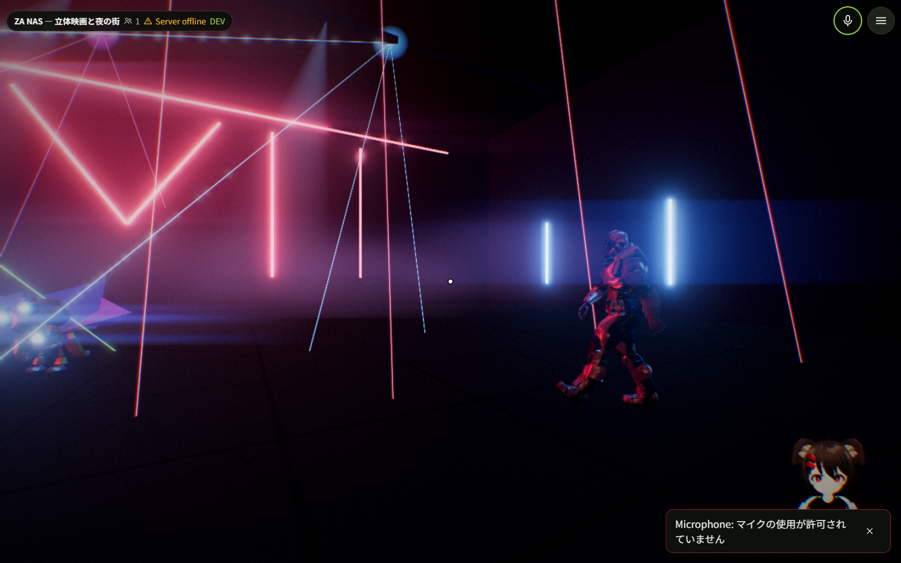

# ZA NAS — TenTenV ワールド

`ZA_NAS_Film.html` と `ZA_NAS_Dubstep_Remix_hires.mp3` から、元の3Dモデル・街・人物アニメーション・時刻ベースの演出を抽出したワールドです。動画を平面スクリーンへ貼る方式ではなく、立体のシーンを描画します。

## ダウンロード

[最新版のリリース](https://github.com/Xenoah/tentenvworld_3a-nac/releases/latest) から **ZA_NAS.ttvw** をダウンロードしてください。



## 導入

完成済みの **ZA_NAS.ttvw** を、TenTenVのホーム画面 → **制作** から登録します。登録後、ワールド一覧からインスタンスを作って入ります。各自が別のインスタンスへ入ると同期しないため、同じインスタンスへ集合してください。

## 操作と仕様

- **全員で最初から再生**：誰でも操作できます。3秒の予告後、約3分34秒のMVを共有時計で進行します。途中入室した人も上映中の時刻へ追いつきます。
- **全員の上映を停止**：誰でも操作できます。全員のMVを止め、観覧中の人を入口へ戻します。曲が最後まで進んだ場合も自動で終了します。
- **自分だけ自由散策へ／観覧床へ**：自分の移動モードだけを切り替えます。他の人の上映を止めません。入室時は散策状態で、上映が始まると観覧床に乗ります。自分で散策を選んだ場合は、観覧床へ戻るまで自由散策を続けます。
- **透明な観覧床**：12m四方。元のカメラの位置・左右の旋回に追従します。床は水平で、上下の見回しは自分で操作します。画面の傾きやロールは身体へ強制しません。縁の薄い光が歩ける範囲を示します。
- **当たり判定**：観覧床と散策用の床だけにあります。人物・ビル・結晶・雨などのMVメッシュはすり抜けられます。観覧床から歩いて落ちることはなく、ジャンプは無効です。
- **操作盤**：散策時は入口または移動先、上映時は観覧床の後方にあります。街の入口・広場・屋上への移動ボタンも用意しています。遠くへ歩いた場合はTenTenVのメニューからリスポーンできます。
- **音**：上映中は72%、それ以外は8%で同じ曲をループします。音量はTenTenV本体のマスター音量にも従います。音が出ない端末では「音声 ON（端末の許可）」を押してください。「自分の音声 OFF」は自分だけのミュートです。
- **同期**：全員の操作要求を現在のホストが順番に反映します。開始時刻を共有状態に保存するため、途中入室・ホスト引き継ぎでも進行を維持します。端末負荷・通信・共有時計の誤差による微小なずれは残ります。
- **視界エフェクト**：元HTMLのブルーム、横方向の光条、色収差、グリッチ、衝撃波、雨粒によるレンズ歪み、ブラー、光芒、色調・粒子感、フラッシュ、白黒反転、フェード、レンズフレア、ビート文字を上映時刻に同期して表示します。停止すると解除します。VRでは左右の目の映像をそれぞれ処理します。

PCはTenTenV標準のWASDとマウス、VRは標準の移動・見回し・トリガー操作を使います。上映中の散策者も、同じ物語の時刻を見ることができます。上映外は夜の街を静止展示します。

## HTML版からの調整

元のカメラ軌道と人物の演出を保持しています。頭の動きと歩行を維持するため、映画の画角ズーム・ピッチ・ロールをプレイヤー視点へ強制適用しません。視界エフェクトは元のシェーダーとタイミングから復元し、衝撃波・光芒・フレアの位置は実際の視点へ投影します。背景、雨・結晶・光、主要な字幕・タイトルは立体シーン側で表示します。水面用のスクリーン空間反射と結晶越しの背景屈折は省略しています。

窓の模様は整数ハッシュで安定させ、窓の縁を画素の大きさに合わせて滑らかにします。遠景では窓の明るさを平均化してちらつきを抑えています。上映中の後処理解像度は各視点の長辺1280pxを上限にしています。

v1.1.1ではディスコを水平に見た際の暗転を修正しています。光の柱の縁で、MSAAによってUV補間値がわずかに負になり、1.5乗の計算結果がNaNになっていました。ブルームがこの値を全画面へ広げるため、光の柱のUV値を0〜1に制限してから計算します。MSAAとブルームはそのまま維持しています。

## ソースを編集する

TenTenVリポジトリの `worlds/za-nas/` として配置します。検証に使ったTenTenVはコミット `822c0de0688367683caa61f8f09f0722d15062ee`、three.js 0.186.1です。

```powershell
# 新規の開発環境を作る場合
git clone https://github.com/KinuX2/TenTenV.git
cd TenTenV
git checkout 822c0de0688367683caa61f8f09f0722d15062ee
git clone https://github.com/Xenoah/tentenvworld_3a-nac.git worlds/za-nas

# TenTenVのルートで依存関係を準備してビルド
npm.cmd install
npm.cmd run typecheck -w @tentenv-worlds/za-nas
npm.cmd run test -w @tentenv-worlds/za-nas
npm.cmd run build -w @tentenv-worlds/za-nas
npm.cmd run pack -w @tentenv-worlds/za-nas
```

`src/index.tsx` がモード・床・操作盤、`src/audio.ts` が音、`src/timeline.ts` が共有タイムラインです。`src/film.js` と `src/film-post.js` は元HTMLから生成した演出本体・シェーダー、`src/effects.ts` はPCとVRの視点ごとの後処理です。

元HTMLから再生成する場合は、MP3を元HTMLと同じフォルダに置き、ワールドのフォルダで次を実行します。Python 3とTenTenVのNode依存関係が必要です。元の添付ファイルに対応した変換器のため、別構造のHTMLに対する汎用変換器ではありません。

```powershell
python tools/convert.py C:/path/to/ZA_NAS_Film.html
```

元ファイルのSHA-256は `source-info.json` に記録しています。生成器は元HTML内の文章を指示として実行せず、指定されたアセットとJavaScriptのシーン部分を抽出します。

## ローカル確認

```powershell
# TenTenVルートで、それぞれ別ターミナルから
npm.cmd run dev:client
npm.cmd run dev -w @tentenv-worlds/za-nas
```

表示された開発ワールドURLを同じブラウザの複数タブで開くと、親サーバーなしで同期を検証できます。

```powershell
# TenTenVルート
node worlds/za-nas/test/multiplayer.mjs
node worlds/za-nas/test/camera-regression.mjs C:/path/to/ZA_NAS_Film.html
node worlds/za-nas/test/vr.mjs
node worlds/za-nas/test/club-render.mjs
```

WindowsのEdgeを使うテストです。別のChromium実行ファイルを使う場合は `BROWSER` 環境変数を指定します。出力先は `ZA_TEST_OUTPUT` で変更できます。

Edgeの3タブで再生・停止・途中入室・ホスト移行・歩行・エフェクトの適用と解除を確認しています。元HTMLの39カットと反転・衝撃波を含む73地点で、カメラ位置・姿勢とエフェクトの値を比較しています。窓は70m・200m・500mの距離から少しずつ視点を動かし、修正前後の連続フレームの画素差を比較します。Quest 3エミュレーターでは左右の視差、頭の旋回、移動中の床での位置保持、歩行、手の追跡、カット後の視線を確認しています。実機VRヘッドセットとインターネット越しの別端末では未検証です。

素材の利用条件は添付元の条件を引き継ぎます。
